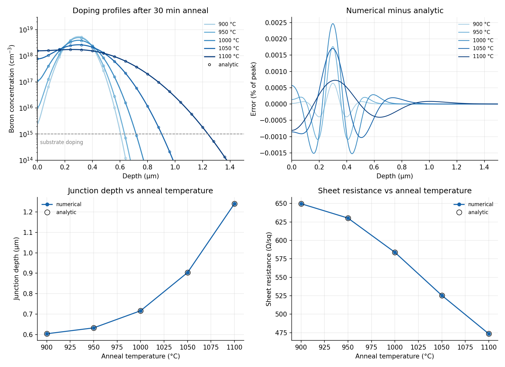

# Boron Implant and Anneal Diffusion Model

A Python model of a boron ion implant into n-type silicon followed by a 30-minute anneal at 900 to 1100 °C. It solves Fick's second law numerically (Crank-Nicolson), checks the solver against the exact analytic solution, and extracts junction depth and sheet resistance as functions of anneal temperature.

**Tools:** Python (NumPy, SciPy, Matplotlib). Runs in Google Colab with no installs.

**Author:** Kiranmayee Vaddepally, M.Tech Quantum and Solid State Devices, IIT Hyderabad

## What the model does

1. Sets up the as-implanted Gaussian profile (dose Q, projected range Rp, straggle dRp) with a mirror-image term so the total dose is exactly Q.
2. Solves dC/dt = D d²C/dx² with a Crank-Nicolson scheme and zero-flux boundaries, with D = D0 exp(-Ea/kT).
3. Compares the result with the exact analytic solution (each Gaussian widens: σ² = dRp² + 2Dt).
4. Extracts junction depth (where boron concentration falls to the substrate doping) and sheet resistance (integral of mobility × net hole density over the junction).
5. Runs a grid and time-step convergence study.

## How to run
1. Open `Boron_implant_anneal_diffusion_.ipynb` in [Google Colab](https://colab.research.google.com) (File > Upload notebook).
2. Choose Runtime > Run all.
3. To try other values, change the Inputs cell (dose, range, straggle, substrate doping, anneal time and temperatures) and re-run.

## Results (100 keV boron, dose 1e14 cm⁻², substrate 1e15 cm⁻³, 30 min anneal)

|Anneal (°C)|Junction depth (µm)|
|-|-|
|900|0.605|
|950|0.633|
|1000|0.717|
|1050|0.903|
|1100|1.240|

* Junction depth increases and sheet resistance decreases with anneal temperature.
* Numerical vs analytic profile: max error under 0.003% of peak concentration. Dose is conserved to about 1e-11 %.
* Convergence at 1000 °C: junction-depth error fell from 0.0205% to 0.0005% as the grid was refined from 4 nm to 0.5 nm spacing.
* **Sheet resistance is reported as a trend only.** Two published hole-mobility parameter sets give values that differ by 25 to 31% (for example about 650 vs 864 Ω/sq at 900 °C), so absolute values are not quoted.

## Parameters and sources

|Parameter|Value|Source|Status|
|-|-|-|-|
|Boron Rp, 100 keV in Si|0.2994 µm|SFU lecture table, attributed to Gibbons, Johnson and Mylroie (*Projected Range Statistics*)|Cross-checked against CityU AP6120 ch. 9 (0.2968 µm)|
|Boron straggle, 100 keV|0.0710 µm|same table|Cross-checked against CityU (0.0735 µm)|
|D0, Ea (intrinsic boron diffusivity)|0.76 cm²/s, 3.46 eV|CityU AP6120 ch. 8|Single source|
|Hole mobility|Arora set (54.3, 407, 2.35e17, 0.88)|COMSOL semiconductor documentation (Arora et al. 1982)|Alternative set also included; models disagree|
|Dose, substrate doping, anneal time|1e14 cm⁻², 1e15 cm⁻³, 30 min|Chosen design inputs|Not measured data|

Sources:

* SFU lecture notes (range table): https://www.sfu.ca/\~gchapman/e495/e495l7o-2.pdf
* CityU AP6120, chapter 9 (ion implantation): https://www.cityu.edu.hk/phy/appkchu/AP6120/9.PDF
* CityU AP6120, chapter 8 (diffusion): https://www.cityu.edu.hk/phy/appkchu/AP6120/8.PDF

## Assumptions and limitations

* Constant, intrinsic diffusivity; no concentration-dependent diffusion and no transient enhanced diffusion from implant damage.
* No dopant loss through the surface and no segregation at an oxide interface.
* All boron is electrically active (full ionization, no clustering).
* Hole mobility depends on total impurity concentration only, at 300 K.
* No channeling tail; the implanted profile is an ideal Gaussian.
* This is a first-principles model of the basic physics, not a replacement for a process simulator such as Sentaurus Process.

